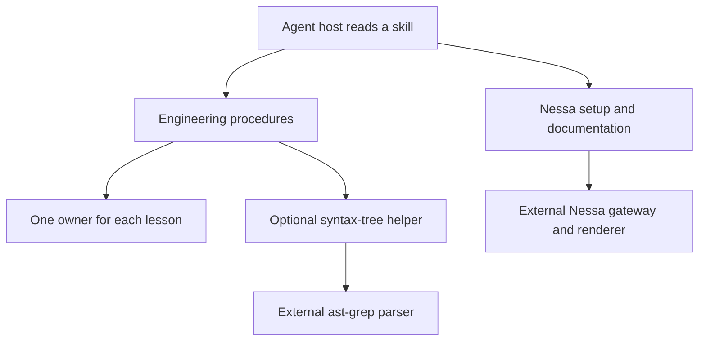

# Choose an engineering or Nessa skill

This repository gives an agent written procedures for engineering work and Nessa setup. It does not run an agent service. Most files are instructions the host reads; the trace helper is the only executable tool shipped here.

For example, when a message goes missing, use Trace to locate the path, Method to investigate the cause, Coding to make a supported change, and Pull requests to explain the result. These are cooperating procedures, not automatic stages enforced by a scheduler.

| Your task                              | Start here                                          |
| -------------------------------------- | --------------------------------------------------- |
| Install the set or understand updates  | [Installation](installation.md)                     |
| Find the one file that owns a rule     | [Ownership and inventory](ownership.md)             |
| Change code or choose tests            | [Coding and tests](coding.md)                       |
| Decide module boundaries               | [System design](design.md)                          |
| Investigate a bug or performance claim | [Evidence and plain explanations](investigation.md) |
| Follow a runtime path                  | [Trace and its helper](trace.md)                    |
| Add coverage for recent fixes          | [Test-gap review](test-gaps.md)                     |
| Write or review a PR                   | [Pull requests](pull-requests.md)                   |
| Connect another computer to Nessa      | [Computer setup](connect.md)                        |
| Author a state atlas                   | [Nessa Docs procedure](authoring.md)                |
| See what was checked here              | [Verification and limits](verification.md)          |

The checked-in plugin manifest lists nine skills: seven engineering and two Nessa skills. The README's “all seven” sentence describes the engineering group; it is not the whole plugin count. The source checkpoint is this repository's revision. A target project, agent host, Tailscale installation or Nessa binary has its own version and evidence boundary.
