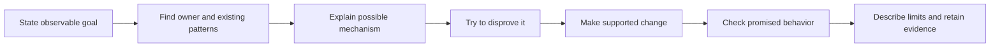

# Make a change and choose its evidence

Start by stating what must become true for the person using the software. The coding procedure then finds the owner, tests a possible explanation, makes the smallest supported change and records evidence that matches the claim.

For example, “the second message never arrives” is an observable failure. “The queue is broken” is a hypothesis. Trace the relevant path and reproduce the missing condition before choosing a fix. A passing unit test for a helper does not establish that the message crosses the real client/server boundary.

The [coding loop](../../skills/engineering/coding/SKILL.md#0-the-loop) owns the detailed procedure. Its failure-first section asks what happens on interruption, repetition and concurrency before the happy path. The [testing reference](../../skills/engineering/coding/references/testing.md) owns which tests are appropriate; it is not replaced by a rule to add tests mechanically to every edit.

Use the Rust or React/TypeScript reference when working in those languages. For another language, follow existing project conventions and state that no language-specific reference was applied. The procedure is guidance read by an agent, not an executable guard. This atlas does not claim a TLA model proves an agent will follow the loop.
