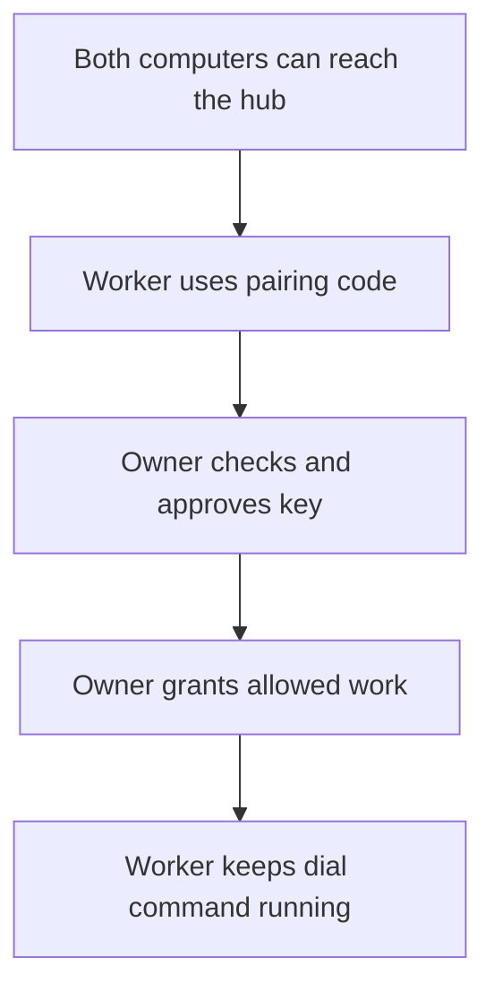

# Connect a computer and check what it may run

The other computer calls the Nessa hub and keeps that connection open. First establish network reachability; then enroll, approve and grant the specific work it may run.

For example, a worker can be approved and show Online but still be unable to run an agent because no grant was given. Pairing, transport connection and permission to run are distinct decisions.

The [setup procedure](../../skills/nessa/connect-a-computer/SKILL.md) owns commands and approval guidance. It distinguishes tailnet reachability from the hub listening beyond loopback. A successful ping with a refused port points at listener/firewall/access rules, not a reason to mint repeated pairing codes.

Enrollment needs compatible lease protocols and private configuration. A code may be used, mistyped or expired; a waiting approval is not a grant. The source tells the agent to check the intended key before approval and to grant only the requested agent/command capability.

Dial serves only while running. Its drain deadline changes graceful stop behavior; a service manager is needed to survive logout/restart. This repo contains setup instructions, not Nessa's pairing, grant or process implementation. Actual commands were not run on another computer for this atlas. Product behavior must be checked against the deployed Nessa version before diagnosing a real machine.
