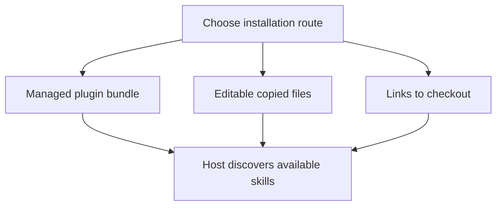

# Install one copy of the skill set

Choose one installation route so the agent does not discover duplicate skills. Installation makes instruction files available; it does not establish that an agent followed them correctly.

The README documents a managed Claude plugin, editable copies through skills.sh, and manual symlinks. The [installation instructions](../../README.md#installation) own the actual commands. The managed plugin updates as that host manages its bundle. Copied skills require the documented update command. Manual symlinks read the current checkout, so pulling that checkout changes what the host reads.

The manual loop in the README names the seven engineering skills. It does not install the two Nessa skills by that loop. To make Nessa setup or documentation available, use a route that selects those directories too. Plugin discovery uses `.claude-plugin/plugin.json`; host-facing labels live in each skill's `agents/openai.yaml`.

An installed skill does not grant new account access, credentials, a checker, or a running service. The external installers and host update behavior were not executed for this atlas. If a skill is missing, inspect which directory the host actually loaded before installing a second copy.
