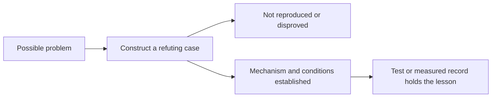

# Turn a suspicion into evidence and explain it

A plausible explanation is a starting point, not a verified defect. Method guides the investigation; wdym guides how to explain the result in words the reader can follow.

For example, a timeout may suggest lost work, but the remote operation may still be running. First identify the observable symptom and the preconditions. Then use the relevant instrument: a small reproduction, property test, concurrency exploration, differential test, trace or measurement. Keep the outcome and the scope of that evidence separate.

The [Method procedure](../../skills/engineering/method/SKILL.md) separates finding, verifying and preventing drift. Its evidence table distinguishes a configured job from an executed pass, a hypothesis from a reproduction, and a benchmark from a general performance guarantee. It recommends adding instruments as the recurring defect class justifies them, not installing every tool at once.

When reporting, [wdym](../../skills/engineering/wdym/SKILL.md) starts with the plain claim, then adds necessary detail. Invoking it asks for a clearer restatement, not new claims. Keep technical conditions that affect correctness even when replacing jargon. This atlas uses simplified explanations but leaves each general rule with its source owner.
