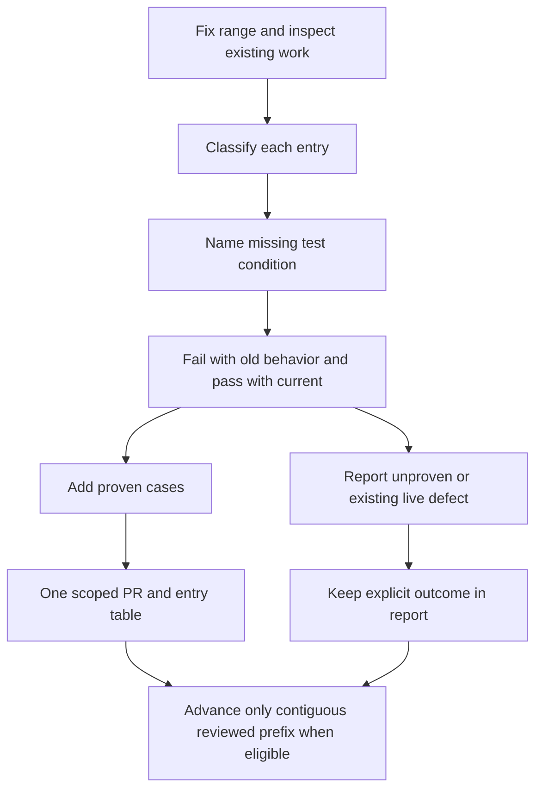

# Review recent fixes without skipping unseen work

Test-gap review asks which condition let a real fix escape existing tests. It adds a case only when putting the old behavior back makes that case fail and the current behavior makes it pass.

For example, a test may cover the first message but never a second message after reconnect. The goal is that missing condition, not a higher coverage percentage. The source procedure lists skipped entries too, so a saved cursor cannot silently jump past work that was never reviewed.

## Choose the review range

An explicit user range wins. Otherwise the procedure uses this machine's saved last-reviewed commit, or the last 24 hours of the fetched default branch. It fixes the ending commit before work begins, checks ancestry and handles shallow history. Read the [exact range rules](../../skills/engineering/test-gaps/SKILL.md#which-commits-to-look-at); this page does not invent a different cursor store.

The procedure reviews at most 20 fixes, oldest first, finishing the entry where that cap falls. Existing open test-gap PRs prevent duplicate cases. An empty range creates no PR. A review-only request writes neither tests nor the state file.

A current-branch failure is a live defect, not permission to weaken the new test. The skill directs it to a separate issue and keeps the coverage change scoped. Scheduled runs use draft PRs and distinguish preexisting failures from failures they caused. The local cursor is per machine and does not establish a cloud job remembered earlier work.

This is a prescribed agent workflow. No scheduler or persisted runtime state machine is implemented in this repository, so no runtime TLA model is claimed for it.
