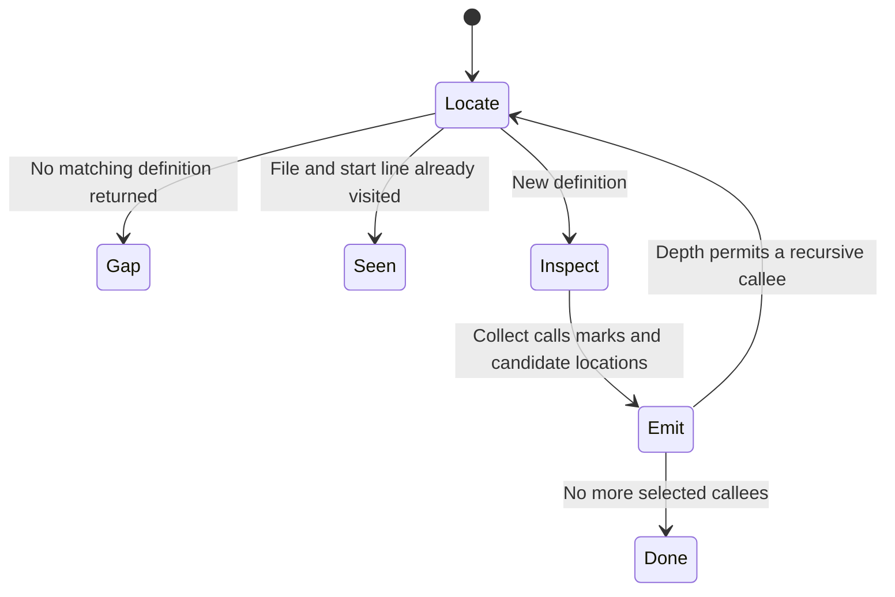

# Follow calls without mistaking candidates for proof

Trace helps you answer “what runs when this happens?” Start with an actual entry point and a fixed source revision. The helper returns candidate calls and locations; the agent must still read conditions and confirm which implementation runs.

For example, a name tagged as a lock may not acquire any lock at all. Tags come from name patterns. A missing definition may be an external call, dynamic dispatch, unsupported syntax or a parser failure. None of those results proves that no work occurs.



## Use the result

The [Trace procedure](../../skills/engineering/trace/SKILL.md) distinguishes understanding mode from debugging. Understanding follows required branches and ends with gaps. Debugging starts with observable symptoms and candidate mechanisms, follows relevant branches and ends with suspects, probes, invariants and a test location. A source trace does not itself reproduce a bug.

Run the helper from its skill directory with Python and an available ast-grep:

```sh
python3 scripts/expand.py main --root /absolute/project --lang python --depth 2 --json
```

The root must be the codebase you intend to read. `--in` narrows the starting definition. Positive depth counts the root as the first level: `--depth 2` inspects the root and one level of selected callees. Without a language, extension counts select one; generated/dynamic code and unsupported syntax require manual follow-up. If no installed ast-grep/sg is detected, the helper can invoke npx to obtain it. That external installation and parser are separate from the source being traced.

## What the implementation actually selects

Definitions are deduplicated by file and starting line. Calls are deduplicated by callee text within one definition; source order is retained. Resolution sorts same-file and same-directory candidates first and retains up to five. Recursive expansion takes the first candidate's file, then looks up the bare name again in that file. All matching definitions there can be inspected, including same-named methods on different types. Qualified lookup falls back to the bare name when no qualified hit exists. Confirm ambiguity instead of treating the first candidate as type resolution.

The current script recurses depth-first, despite its docstring/skill describing the expansion as breadth-first. It scans whole files for matches and filters the definition's line range, despite “only the body parsed” wording. `--depth` controls recursive expansion, not an exhaustive call graph; zero or negative values still inspect the root. These are source-observed documentation discrepancies, not fixed behavior in this atlas.

Parser failures can be printed on stderr and returned as an empty result. The helper therefore cannot distinguish every parser error from a genuine empty match using its JSON alone. Preserve stderr and investigate unexpected gaps. The parser smoke tests here cover a small Python fixture, not every language, overload or generated call.

## Model scope

The bounded model represents four already-resolved definitions, a stack and visited identities, at depth two or three. It checks that a definition is emitted at most once and recursive emissions stay within the requested positive depth. It assumes candidate resolution and depth inputs are valid. It does not prove complete call-graph discovery, parse correctness, type dispatch or breadth-first order. Controls remove visited suppression and the depth guard. Actual traversal tests separately exercise the production Python helper.
