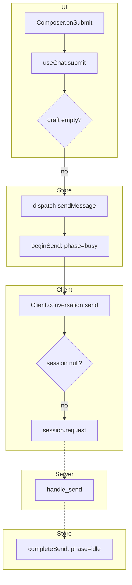

# Trace format

Worked shapes for the `trace` skill. The procedure and the line forms live in
[`SKILL.md`](../SKILL.md); this file is only the picture. The example below
was produced against a real repository at a fixed revision and is here to
show the shape. It is not a trace of that repository today; regenerate before
relying on any hop in it.

---

## ASCII, debugging mode

A blocking pool: the caller pushes a task under one mutex and either wakes an
idle worker or spawns a thread; the worker pops under the same mutex. The
symptom: a task is queued but never runs.

```text
# Trace: spawn_blocking(f) → f runs on a blocking-pool thread
Entry: task::spawn_blocking(f) (src/task/blocking.rs:220)
Question: debugging — the JoinHandle for f is never woken; no error, no panic
Source: tokio @ cf782c5; external: none walked (std Mutex/Condvar via loom shim)

spawn_blocking pushes one Task into one queue behind one mutex. Under that
lock the pusher either wakes an idle worker (notify_one, guarded by a
num_notify counter so the wake cannot be lost) or spawns a thread, unless the
pool is at thread_cap, in which case it does neither and the task waits for
some running worker to finish and loop back to pop. That "someone will pop it"
assumption is the load-bearing decision; a worker that never returns from f
turns "queued" into "queued forever".

Mechanisms considered: M1 lost wake-up between notify and wait  M2 pool at cap
with every worker blocked  M3 thread spawn fails and nothing retries  M4 shutdown
cancels or drops queued work

┌─ blocking::pool · thread: caller ────────────────────────
│ task::spawn_blocking(f) (src/task/blocking.rs:220)
│ └─ Handle::spawn_blocking … Spawner::spawn_task (pool.rs:246…459)
│    [state] JoinHandle minted; task = BlockingTask(f) (:452)
│    └─ LockedImpl::spawn_task (pool.rs:611)
│       ┌─ [lock: mutex] (:620)
│       │  if thread_mgmt_state.shutdown (:622)
│       │  ├─ true  ─▶ task.shutdown() (:626) ─▶ Err(ShuttingDown)
│       │  │           (not the symptom: JoinHandle gets cancelled err)
│       │  └─ false ─▶ queue.push_back(task) (:630)
│       │              [state] queue_depth += 1 (:631)
│       │              if num_idle_threads() == 0 (:633)
│       │              ├─ false ─▶ [state] idle -= 1; num_notify += 1 (:641-642)
│       │              │           ──▶ condvar.notify_one [thread: worker] (:643)
│       │              └─ true  ─▶ on_no_idle (:634 → :476)
│       │                          if num_threads() == thread_cap (:479)
│       │                          ├─ true  ─▶ [SUSPECT S1] no notify, no spawn;
│       │                          │           waits for a busy worker to pop (:479-482)
│       │                          └─ false ─▶ spawn_thread (:490 → :516)
│       │                                      ├─ Ok ─▶ [state] num_threads += 1 (:492-494)
│       │                                      │        ──▶ OS thread starts [thread: worker] (:530)
│       │                                      ├─ WouldBlock & peers > 0
│       │                                      │   ─▶ [SUSPECT S2] queued, no thread, no notify (:496-503)
│       │                                      └─ other ─▶ Err(NoThreads) ─▶ panic (:507, :394)
│       └─ [unlock: mutex] (:646)
└──────────┬───────────────────────────────────────────────
           │  notify_one / OS thread start
           ▼
┌─ blocking::pool · thread: worker ────────────────────────
│ Inner::run → LockedImpl::run_worker (pool.rs:763 → :650)
│ ┌─ [lock: mutex] (:656)
│ │  loop (advances while queue is non-empty):
│ │  ├─ queue.pop_front() (:663)
│ │  │  └─ [unlock: mutex] ─▶ task.run() [opaque: user code f; may block/re-enter] (:666)
│ │  │     └─ [lock: mutex] ─▶ [loop] back to pop_front (:668)
│ │  └─ queue empty:
│ │     [state] num_idle_threads += 1; is_counted_idle = true (:672-674)
│ │     [wait] condvar.wait_timeout — until notify or keep_alive (:677)
│ │            (releases mutex; reacquires on wake)
│ │     if num_notify != 0 (:682-697)
│ │     ├─ true  ─▶ [state] num_notify -= 1 ─▶ [loop] back to pop_front (:686)
│ │     └─ false ─▶ [state] worker removed; num_threads -= 1 ─▶ thread exits (:698-743)
│ └─ [unlock: mutex]
└──────────────────────────────────────────────────────────

## Actor — runtime shutdown

┌─ BlockingPool::shutdown · thread: whoever drops Runtime ─
│ begin_shutdown (pool.rs:748)
│ ┌─ [lock: mutex]
│ │  [state] shutdown = true; shutdown_tx = None (:750)
│ │  ──▶ condvar.notify_all [thread: every idle worker] (:751)
│ └─ [unlock: mutex]
│ [wait] shutdown_rx.wait(timeout) — until every worker returns (:332)
└──────────┬───────────────────────────────────────────────
           │  notify_all (worker wakes with shutdown set)
           ▼
┌─ blocking::pool · thread: worker ────────────────────────
│ while queue.pop_front() (pool.rs:708)
│ └─ if task.mandatory (:712)
│    ├─ true  ─▶ run it
│    └─ false ─▶ task.shutdown()
└──────────────────────────────────────────────────────────
Queued work is run (mandatory) or cancelled (not), never dropped silently. A
worker wedged inside f also wedges an untimed shutdown.

Omitted: sharded queue (opt-in build; structurally different, same at-cap class).

## Suspects

S1 Pool at thread_cap with every worker inside a blocked f, at on_no_idle
   pool.rs:479-482. Produces the symptom whenever no worker returns to
   pop_front. Matches "under load with file I/O".
   Probe: dump all thread backtraces; if every blocking thread is in user code
   and none in Condvar::wait_timeout at pool.rs:677, this is it.
S2 Thread creation fails with WouldBlock while peers exist, pool.rs:496-503.
   Same outcome via ulimit or PID pressure.
   Probe: strace -f -e trace=clone for EAGAIN during the load test.

Ruled out: M1 lost wake-up. notify_one (pool.rs:643) and the num_notify check
(pool.rs:682) both run under the same mutex, and wait_timeout releases and
reacquires that mutex atomically, so a timeout cannot beat a notify.

## Invariants to assert
- Every push_back (pool.rs:630) is followed in the same critical section by
  exactly one of on_no_idle (pool.rs:634) or notify_one (pool.rs:643).
- num_idle_threads changes only at pool.rs:641, 672, 729, each under mutex.

## Where a test goes
- tests/rt_blocking_thread_exhaust.rs, beside the existing exhaustion test:
  max_blocking_threads(1); first closure parks on a channel that is never sent
  to; assert the second JoinHandle does not resolve while
  num_blocking_threads() == 1, then send, then assert it resolves. That
  controls the at-cap transition rather than waiting on a timer.

## Gaps
- Why a given f never returns is the user's code, outside this repo.
- Which waiter notify_one wakes is the platform's condvar; any waiter suffices.
```

What to notice: branches fork inline under each `if`; the `┌─ [lock: mutex]`
bracket wraps the entire critical section including `notify_one`; the worker is
its own box joined by the handoff arrow; the `[wait]` line says which lock it
releases; shutdown is an `## Actor` box; plumbing between `spawn_blocking` and
`spawn_task` is one collapsed line; the ending has four sections and a ruled-out
mechanism with its evidence.

---

## ASCII, understanding mode

Same boxed call chart, every branch shown inline, and only `## Gaps` at the end.

```text
# Trace: submit a chat message
Entry: Composer.onSubmit (ui/composer.tsx:41)
Question: understanding
Source: app @ 3f2c1a9

The draft goes store → client → websocket → server and back; the store marks
the turn busy before the request and idle after the reply or the failure.

┌─ UI ─────────────────────────────────────────────────────
│ Composer.onSubmit (ui/composer.tsx:41)
│ └─ useChat.submit (ui/use-chat.ts:22)
│    └─ if draft.trim() === "" (:24)
│       ├─ yes ─▶ early return (:25)
│       └─ no  ─▶ Store
└──────────┬───────────────────────────────────────────────
           ▼
┌─ Store ──────────────────────────────────────────────────
│ dispatch(sendMessage) (store/chat.ts:80)
│   [state] transcript += user turn; phase = busy (:88)
└──────────┬───────────────────────────────────────────────
           ▼
┌─ Client ─────────────────────────────────────────────────
│ Client.conversation.send (client/conversation.ts:15)
│ └─ if session == null (:17)
│    ├─ yes ─▶ sendMessage.rejected (store/chat.ts:112)
│    │           [state] keep user turn; show error; phase = idle
│    └─ no  ─▶ session.request("conversation.send") (:60)
└──────────┬───────────────────────────────────────────────
           │  WebSocket request
           ▼
┌─ Server (process: server) ───────────────────────────────
│ conversation::handle_send (server/conversation.rs:120)
│   [gap] trait dispatch at :131 (EchoBackend | ModelBackend)
└──────────┬───────────────────────────────────────────────
           │  WebSocket response
           ▼
┌─ Store ──────────────────────────────────────────────────
│ completeSend (store/chat.ts:104)
│   [state] transcript += reply; phase = idle
└──────────────────────────────────────────────────────────

## Gaps
- The server handler dispatches on a trait object at server/conversation.rs:131;
  candidates: EchoBackend, ModelBackend.
```

---

## Mermaid (when allowed)

Same hops as `flowchart TB`, one subgraph per layer, decisions as diamonds,
handoffs as dashed edges, node text as code symbols. Prose header first.

````markdown
# Trace: submit a chat message · Path A


````

Paths B and C are separate diagrams, not hidden branches inside Path A.

---

## What not to do

- Do not collapse failure paths into a footnote on the happy path.
- Do not use remembered traces from an earlier session, including the example
  above.
- Do not invent hops past a stub; write a `[gap]` line.
- Do not mark every state write; mark the ones that gate the observable.
- Do not put a mechanism you have ruled out in the ranked suspects.
- Do not default to printing ASCII and mermaid together.
