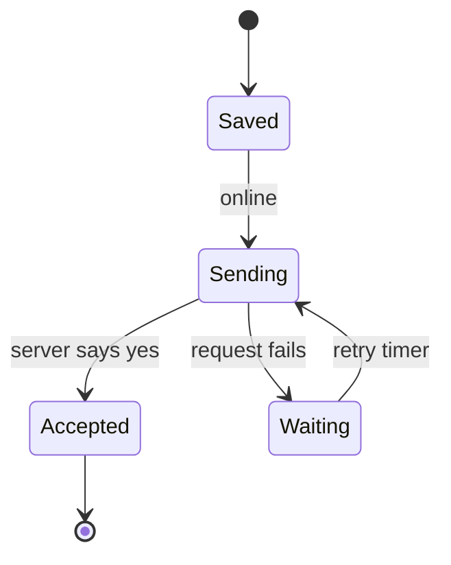

## The short version

Acme Notes loses edits when the laptop goes offline, and that is the top complaint in the sample support log. The app already saves every edit locally, so the missing piece is sending those saved edits once the connection is back.

:::lead label="Recommendation" tag=judgment
Build offline sync for one person on one device first. It fixes the top complaint with pieces the app already has. Leave real-time collaboration for later.
:::

## What users told us

::caption {placeholder: invented survey} These quotes are made up for the example. A real page would use a sourced label that names the survey and its date.

:::quote cite="Respondent 14, sample survey" date="Nov 20, 2026" tag=placeholder
I wrote two pages on the train and they were gone when I got home.
:::

:::quote cite="Respondent 31, sample survey" date="Nov 21, 2026" tag=placeholder
I don't need live editing with my team. I need my own notes to stop vanishing.
:::

## Where the app stands

::caption {sourced: sample repo, read Nov 27, 2026} The middle column comes from the code. The status labels are my judgment.

| Need | What the app has today | Status |
| --- | --- | --- |
| Edits survive going offline | Every edit is saved to a local database first. | {has} |
| Edits reach the server later | A retry queue exists but drops items after 3 tries. | {partial} |
| Two devices editing one note | Last write wins. No merge. | {missing} |

## Options compared

::caption {judgment} {placeholder} The effort numbers are values I picked to show the shape, not estimates.

| Option | Fixes the top complaint | Effort | Main risk |
| --- | --- | --- | --- |
| Finish the retry queue | Yes, for one device | 2 weeks {placeholder} | Old edits arriving after newer ones |
| Real-time collaboration | Yes, and more | 3 months {placeholder} | Large new system to run |
| Do nothing | No | None | Users keep losing work |

## What to do first

::caption {judgment} Ranked by what fixes the most for the least work.

:::ranked
1. **Stop dropping queued edits.** The queue gives up after 3 tries, so a long trip offline loses work. Keep items until the server accepts them.
2. **Send edits in the order they were made.** Without this, an old edit can overwrite a newer one.
3. **Show what is still waiting.** A small "3 edits not sent yet" line tells people their work is safe.
4. **Measure how often two devices clash.** That number decides whether collaboration is worth building.
:::

## Ideas

::caption {judgment} Sample ideas. Each card has the same parts in the same order.

:::idea title="Sync status line" tag=judgment
Pitch: A quiet line at the bottom that says how many edits are waiting to be sent.
Who it's for: Anyone who works on trains or planes.
Why we win: The local database already knows what is unsent.
Smallest first version: A count and a "Send now" button.
Risks: People may worry more when they see a number.
:::

:::idea title="Conflict copy" tag=judgment
Pitch: When two devices clash, keep both versions side by side instead of picking one.
Who it's for: People who edit the same note on a phone and a laptop.
Why we win: It needs no merge logic, only a second copy.
Smallest first version: Save the losing edit as "Note (conflict copy)".
Risks: Too many copies if clashes are common.
:::

:::idea title="Offline notice" tag=judgment
Pitch: Say plainly when the app is offline, so nobody is surprised later.
Who it's for: People who don't notice when the connection drops.
Why we win: The app already checks the connection before each save.
Smallest first version: The word "Offline" in grey next to the note title.
Risks: A notice that flickers on a weak connection is worse than none.
:::

## How one edit moves

::caption {judgment} The life of one queued edit, from the sample design.

:::states
| State | Saved locally | On the server | Leaves by |
| --- | --- | --- | --- |
| Saved | Yes | No | Connection comes back |
| Sending | Yes | Maybe | Server accepts, or the request fails |
| Accepted | Yes | Yes | Final |
| Waiting | Yes | No | Retry timer, with no limit on tries |
:::

:::diagram caption="One queued edit, from save to accepted."

:::

### What must always hold

:::invariants
1. An edit is never removed from the queue until the server has accepted it.
2. Edits to one note reach the server in the order they were made.
3. Sending the same edit twice changes the note once.
:::

## What to skip

::caption {judgment}

:::skip
- Building our own sync protocol. Use the server's existing save call.
- Real-time cursors and presence. They do not fix the top complaint.
:::

## Risks and open questions

::caption {judgment}

### Risks

:::risks
- A very long queue could make the first sync after a trip slow.
- Users on old app versions will still drop edits until they update.
:::

### Open questions

:::questions
- How many users edit on more than one device? This decides the next step.
- Should the "Send now" button exist, or should sending always be automatic?
:::

## How this page was made

Everything here is sample content written to show the components. A real page would say what was read and when, and what was not read.

:::sources
- [build-artifacts format reference](format.md), the directive syntax this page uses
- [wdym](https://github.com/nessalabs/skills/blob/wip/skills/engineering/wdym/SKILL.md), the writing rules the voice builds on
- Sample support log, the team's shared drive at support/2026-11.csv, read Nov 27, 2026 {placeholder}
:::
