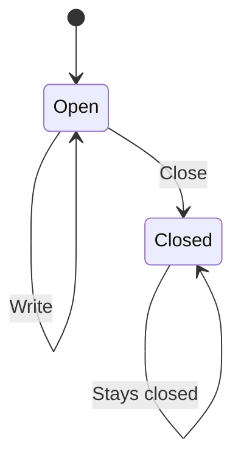

# Nessa Docs

Help a newcomer understand what a project does, which part owns each step,
and why an action succeeds or fails. Write the documentation in the user's
repository. Nessa Docs renders it; it does not run the modeled system. For a
risky flow, add a small rule model and check it before the page is stamped.

Read [the file format](references/format.md) before authoring files. That
reference owns the metadata and diagram-binding contract. The skill is usable
without the website and does not require other skills or a particular agent.

## Find the real behavior

Read the project's working instructions, entry points and existing feature
documentation. Follow the code and relevant tests for the behavior you describe.
For a full-project request, inventory the services, their responsibilities,
important user goals and stateful entities before writing. For a narrow request,
update the existing owning page rather than generating another atlas.

Distinguish implemented behavior, examples, proposals and things you could not
verify. Reading a test is evidence of its intent, not a claim that it passed.
Name concrete gaps, their effect, and the evidence still needed. Do not invent
a lifecycle for immutable values or claim external behavior you could not inspect.
An immutable record can still have an explicit status. In that case a chart may
describe the returned status changes; say that calls return a new value and name
who saves it, rather than implying the original value changes in place.

## Retain the source checkpoint

Record `sourceRevision` in each state page reviewed, following the
[file format](references/format.md#source-review-checkpoint). Use the documented
repository's exact committed source revision, obtained with `git rev-parse HEAD`
(or the exact base checked when source and docs share a working branch). A dirty
implementation is not represented by HEAD alone: commit the source first or keep
the prior checkpoint and describe the uncommitted scope explicitly.

Read the existing checkpoint before refreshing a page. Compare the relevant
source changes since that revision, then trace the current owning code and tests;
a diff alone is not proof the explanation is correct. Advance only pages whose
behavior was reviewed. Do not stamp an entire atlas after a partial audit, inherit
a root revision onto children, substitute the renderer's commit, or imply a
checkpoint is executed test evidence. Leave unknown historical checkpoints
absent until verified. Record review scope, validation and exclusions in prose.

On a page that links a model, run [the rule check](#check-a-risky-flow) before
you stamp that page. The checkpoint names the source you reviewed. It does not
say the rules held.

## Organize the map

Put the system entry in `docs/state/README.md`. For larger projects, group
services under `services/`, with an owning README and useful feature and flow
pages beneath it. Shared libraries can use the same hierarchy. Keep
cross-service explanations with the owner of that interaction and link the
other owners.

Let readers move from the system map to a relevant user goal and its state or
decision explanation. Larger projects can add service and feature levels between
them. Stable IDs and `parent` metadata connect those levels. A document
can serve several user goals without duplicating its lifecycle. Keep one useful
flow index when a feature needs one. Retain unrelated project documentation; replacing it
requires the user's request and preserved evidence links.

Scale the hierarchy to the project. A small module may need only an overview
and one lifecycle page. Add service or feature indexes when they group useful
choices; do not create a chain of pages with just one destination each. Keep
closely related decisions together when separate pages would add navigation
without helping the reader.

## Choose the diagram

- A component map shows parts that exist together. Its arrows describe their
  relationships, not a sequence of exclusive states.
- A statechart follows one entity or operation. Name its owner, entry, meaningful
  states, events, conditions and important refusal or uncertain outcomes.
- A small sequence explains who hands work to whom and in what order. Use it
  when it makes an explanation easier to follow, not on every page.
- A contract page explains a value or rule that has no runtime lifecycle.

Apply [Harel's statechart ideas](https://www.state-machine.com/doc/Harel87.pdf)
where the actual system supports them. Nested states refine an outer state;
shared outer transitions avoid repetition. Concurrent regions describe facts
that coexist, with explicit coordination. History means returning to a prior
configuration; say what is remembered, where, and for how long. Mermaid supports
only part of this notation. Do not promise resume or persistence from a history
symbol, or completion or erasure from a final marker alone.

Keep accepted work, performed effects, acknowledgements and completed cleanup
distinct when the code does. Do not force independent lifecycles into one large
application state. Avoid a box for every function or field. Use
`event [condition] / action` on state arrows when those parts matter.

## Write for the first reader

Open each page and clickable explanation with plain English. Say what happens,
what allows or prevents the next step, and what the reader can expect afterward.
A state or arrow may be the first thing the person reads. Explain its condition
without requiring the rest of the page. Add a small example or sequence when it
helps. Keep important failure and uncertainty visible in the short explanation.

Use short sentences and ordinary verbs. No em dashes, slogans, filler or invented
jargon. Keep function names, exact error types and test-name lists out of the
opening explanation. Add a few useful source links for readers who want the
implementation; the complete source list belongs in frontmatter. Do not replace
a wall of prose with a wall of boxes.

Use `diagramLinks` for drill-down into another page and `diagramDetails` for an
explanation in the owning Markdown. The browser marks available depth with a +.
Full detail shows authored content; it does not launch agents or write files.

## Check a risky flow

A chart says what is allowed. A model is that story written so a checker can
try the steps and see whether the rules still hold. Not every page needs a
model. Write one for a risky flow: pairing, leases, saving a secret, cleanup,
and resume. The [file format](references/format.md#optional-rule-model) owns
the fields. This section is how you write and check the model.

The model checks the design, not the code. A rule that holds here is not
evidence the program does the same thing.

### Files

Put a real `MODULE.tla` and `MODULE.cfg` under `docs/state/tla/`, mirroring the
page path. `docs/state/services/sdk/attachment.md` links
`tla/services/sdk/attachment.tla` and `tla/services/sdk/attachment.cfg`:

```yaml
model:
  spec: tla/services/sdk/attachment.tla
  config: tla/services/sdk/attachment.cfg
  steps:
    Init: Start with the attachment open.
    Close: Close the attachment.
    Write: Write bytes.
    Done: The attachment stays closed.
```

Paths are relative to `docs/state`, stay inside `tla/`, and contain no `..`.
`model.steps` maps each TLC action name to one plain sentence. `Init` is the
start. It is the first step of a failing path, and it is not an action inside
`Next`.

Use the chart's state ids as the model's string values. `phase = "Closed"`
marks the chart state `Closed` when a rule breaks there.

`validate:docs` needs the linked files to exist, and each file must be linked
by exactly one page. That command does not run the checker.

### Rules

Turn each of the page's "must always hold" lines into an `INVARIANT`. Turn a
claim about what happens over time (a lease is released, a cleanup finishes)
into a `PROPERTY`. Name each one in the `.cfg`. A sentence you leave off
that list is not checked.

Write `Next` as a disjunction of named actions, the same names as `steps`
except `Init`: `Next == Close \/ Write \/ Done`.

Keep models small. The checker stops at 2,000 distinct states or 20 seconds.
A rule still unfinished at that stop is not checked, and not checked is not a
pass.

Never weaken a rule to make it pass. Do not drop an invariant, add a guard the
page does not claim, or delete the step that breaks it. Change the chart and
the model together, or keep the break.

Say what the model leaves out, on the page, in a sentence or two.

### Check before you stamp

Before you stamp the page, call `check_model`. It is the same check as the
app's **Check rules** button.

If the checker is missing, install it and call again: `check_model` with
`action` set to `install`, then a check. Settings → Health has the same
install. A missing checker is not a pass. Nothing was held.

When the page and both files are in the current bundle, pass `page` (the
document id, or its `docs/state` path). A finished check writes `modelCheck`
on the page. When the model is not in the bundle yet, pass `spec`, `config`,
and `steps` together. That returns the same findings and writes nothing.
Pass one of those two. The tool rejects a call that includes both. When you
are editing the project files yourself, press **Check rules** on that page
so the checker writes `modelCheck`.

Never hand-write `modelCheck`. The checker writes it. A result you paste in
is not a check. A run that fails to parse, or that is cancelled, leaves the
previous result in place. Read the message, and do not report that old result
as this check.

Read back the rules held, the rules broken with their numbered path and the
chart states they marked, the rules not checked, and the state count. Report
all four, including the empty ones. Then record `sourceRevision` as the
checkpoint section says. If a rule broke, or any rule was not checked, say
that in the checker's words. The checkpoint does not turn either into a pass.

### A failing path

Replay each failing path as a real test in the documented repo, one step per
action, before calling it a code bug. If the code does not fail that way,
treat the model as wrong until shown otherwise.

### Worked example

Closing an attachment. The chart states are `Open` and `Closed`. The page says
a write never happens after close, and the attachment is either open or closed.
The model leaves out the bytes already stored. It only checks those two rules.



```tla
---- MODULE Attachment ----
VARIABLES phase, wroteWhileClosed
vars == <<phase, wroteWhileClosed>>
Init == phase = "Open" /\ wroteWhileClosed = FALSE
Close ==
    /\ phase = "Open"
    /\ phase' = "Closed"
    /\ UNCHANGED wroteWhileClosed
Write ==
    /\ phase = "Open" \* guard: writing requires the attachment to be open
    /\ wroteWhileClosed' = (phase = "Closed")
    /\ UNCHANGED phase
Done ==
    /\ phase = "Closed"
    /\ UNCHANGED vars
Next == Close \/ Write \/ Done
NoWriteAfterClose == wroteWhileClosed = FALSE
OnlyOpenOrClosed == phase \in {"Open", "Closed"}
Spec == Init /\ [][Next]_vars
====
```

```text
SPECIFICATION Spec
INVARIANT NoWriteAfterClose OnlyOpenOrClosed
```

With the guard, both rules hold. The saved check reports 2 states. Remove the
`phase = "Open"` guard on `Write` and `NoWriteAfterClose` breaks:

1. Start with the attachment open.
2. Close the attachment.
3. Write bytes.

The last state is `Closed`, so the chart marks `Closed`. `OnlyOpenOrClosed`
still holds. The test to replay is open, then close, then write, and expect
the write to be refused. If the code refuses it, the model was wrong to allow
`Write` after `Close`. If the code accepts it, the code has the bug the model
found.

## Check and open

Check stable IDs, parents, relative links, headings, Mermaid syntax and diagram
targets. If the local Nessa Docs checkout is available, run its catalog check:

```sh
npm run --silent validate:docs -- --project /absolute/project/path
```

Run it from the renderer checkout, not the documented project. It prints JSON
and returns a nonzero exit code for an invalid catalog. A missing model
file, or one file linked by two pages, is an error, as
[the rule check](#check-a-risky-flow) describes. This command does not run
the checker. Open the project in the app to inspect charts and
Settings → Health when a browser is available. Without a browser, report
that visual appearance and interaction were not checked.
A syntactically valid chart still needs a behavior check against its source.
Report exclusions.

To open the project, start the separate renderer with `npm start` after its
dependencies and build are ready, then use Open project with the absolute project
folder. A configured start can use
`NESSA_DOCS_PROJECT=/absolute/project/path npm start`. If the renderer is not
installed, direct the user to [nessalabs/nessa-docs](https://github.com/nessalabs/nessa-docs)
and its setup instructions. Do not imply that installing this skill also installs
or starts the app, or that a Codex extension is already available.

## When the host offers Nessa Docs MCP tools

Keep the same document format. Use `replace_docs` with a complete bundle of
`{ path, markdown }` files and `expectedRevision: 0` for an empty bundle, then
`show_docs` to open its explorer. For updates, read `read_docs`, reconcile its
`snapshot.files`, and replace using that snapshot's revision. Never silently
retry a conflict by overwriting a newer revision. Memory mode is session-only. If the operator selected `NESSA_DOCS_STORE` at
startup, generated Markdown is saved only under that dedicated store and survives
restart. Read `read_docs` after reconnecting; a saved revision does not reset to
zero. A save-unconfirmed error may have committed, so read/reconcile before
retrying. Managed generation paths are standalone snapshots with bounded
retention; read for the latest path before opening. Tools never choose arbitrary
paths, write into a source project's docs/state or read source files. State which
content is synthetic/proposed and which source you actually verified.

`check_model` runs [the rule check](#check-a-risky-flow). Include the `.tla`
and `.cfg` in the bundle when you pass `page`, so a finished check can write
`modelCheck`. Text passed as `spec` and `config` writes nothing.
